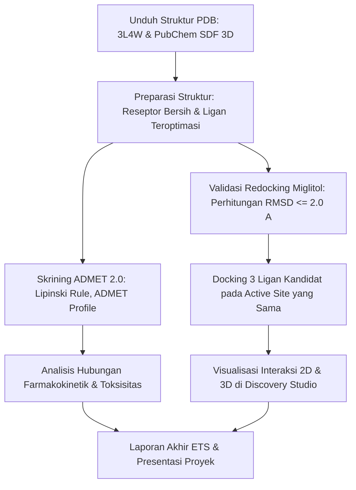

# 🧬 Project ETS Visualisasi Data Medis — Kelompok 3
> **Simulasi Molecular Docking dan Analisis In Silico Senyawa Bahan Alam Terhadap Enzim $\alpha$-Glukosidase (PDB ID: 3L4W) sebagai Kandidat Terapi Diabetes Melitus**

---

## 👥 Profil Anggota Kelompok 3 & Pembagian Peran

| No | Nama Mahasiswa | NRP | Peran & Tanggung Jawab Utama | Folder Kerja |
|:--:|:---|:---:|:---|:---|
| 1 | **Ziyadatur Rif'ah** | 5049241013 | **Perumusan Target & Kandidat:** Studi pustaka target protein (3L4W), seleksi 3 ligan kandidat antidiabetes, dan penyusunan pendahuluan laporan. | Dokumen Laporan |
| 2 | **Ni Wayan Melva Vemitra** | 5049241006 | **Preparasi Makromolekul & Ligan Alami:** *Cleaning* struktur protein 3L4W (penghapusan molekul air, ion, gliserol, dan ligan native di BIOVIA Discovery Studio). | `orang 2 melva/` |
| 3 | **Desta Kezia Priyono** | 5049241003 | **Preparasi Ligan & Uji ADMET:** Minimisasi energi UFF pada ligan kandidat, konversi ke format `.pdbqt`, dan skrining farmakokinetik/toksisitas di ADMETlab 2.0. | `orang 3 kezia/` |
| 4 | **Najma Khoirun Nisa** | 5049241034 | **Validasi Metode (Redocking):** Penentuan parameter Grid Box, simulasi redocking ligan native (Miglitol) di PyRx/AutoDock Vina, dan verifikasi RMSD $\le 2$ Å di PyMOL. | `orang 4 najma/` |
| 5 | **Fidellynne Khaleesha Abidi** | 5049241008 | **Molecular Docking Kandidat:** Simulasi penambatan molekuler 3 ligan kandidat, ekstraksi energi ikatan (*binding affinity* kkal/mol), dan penyimpanan pose terbaik. | `orang 5 fidel/` |
| 6 | **Aisyah Rahmi Nadjib** | 5049241030 | **Visualisasi & Analisis Interaksi:** Visualisasi interaksi 2D/3D (ikatan hidrogen, interaksi hidrofobik), pembahasan komparatif literatur, serta integrasi laporan & repositori. | Laporan & Repositori |

---

## 🎯 Target Makromolekul & Senyawa yang Diuji

* **Reseptor Target:** Enzim Human Intestinal $\alpha$-Glucosidase / Nt-MGAM (**PDB ID: [3L4W](https://www.rcsb.org/structure/3L4W)**)
* **Ligan Native (Kontrol Validasi):** Miglitol
* **3 Senyawa Kandidat Bahan Alam:**
  1. **Quercetin** (PubChem CID: [5280343](https://pubchem.ncbi.nlm.nih.gov/compound/5280343))
  2. **Luteolin** (PubChem CID: [5280445](https://pubchem.ncbi.nlm.nih.gov/compound/5280445))
  3. **Mangiferin** (PubChem CID: [5281647](https://pubchem.ncbi.nlm.nih.gov/compound/5281647))

---

## 🔄 Alur Kerja Simulasi (In Silico Workflow)



1. **Preparasi Makromolekul:** Pemisahan kofaktor, molekul air, dan ligan kristalografi dari rantai reseptor.
2. **Preparasi Ligan:** Optimasi konformasi 3D dan minimisasi energi menggunakan *force field* UFF.
3. **Uji ADMET:** Evaluasi parameter fisikokimia, *drug-likeness* (*Lipinski's Rule of Five*), absorpsi, dan toksisitas organ/mutagenisitas.
4. **Validasi Redocking:** Redocking ligan alami (Miglitol) untuk mengonfirmasi bahwa algoritma docking mampu memprediksi pose kristalografi sebenarnya (RMSD $\le 2.0$ Å).
5. **Molecular Docking Kandidat:** Simulasi penambatan Quercetin, Luteolin, dan Mangiferin pada ruang koordinat *grid box* yang identik.
6. **Visualisasi Data & Interpretasi:** Pemetaan asam amino kunci kantung aktif reseptor, ikatan hidrogen, kontak van der Waals, dan interaksi hidrofobik.

---

## 📁 Struktur Direktori Repositori

```text
Group3_Visdat/
├── orang 2 melva/            # Reseptor 3L4W bersih (.pdb) & catatan preparasi
├── orang 3 kezia/            # Ligan kandidat (.pdbqt), laporan ADMET (.pdf, .csv)
├── orang 4 najma/            # Parameter Grid Box, hasil redocking Miglitol (.pdb, .csv, jpeg)
├── orang 5 fidel/            # Pose docking kandidat (.pdb), tabel binding affinity, gambar pose
├── jurnal acuan/             # Jurnal referensi ilmiah (Luteolin, Mangiferin, Quercetin)
├── K5, K6, K7...pdf          # Slide materi kuliah (lengkap dengan teks OCR searchable)
├── Penugasan_Project...pdf   # Panduan teknis penugasan ETS
└── README.md                 # Dokumentasi proyek kelompok
```

---

## 🛠️ Software & Platform

* **RCSB Protein Data Bank (PDB)** & **NCBI PubChem**
* **BIOVIA Discovery Studio Visualizer**
* **PyRx (AutoDock Vina & Open Babel Integration)**
* **PyMOL Molecular Graphics System**
* **ADMETlab 2.0 Web Platform**
