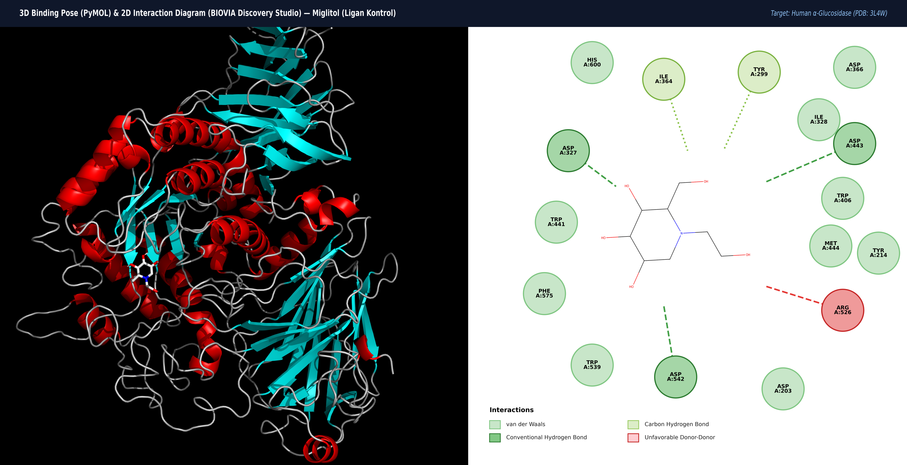
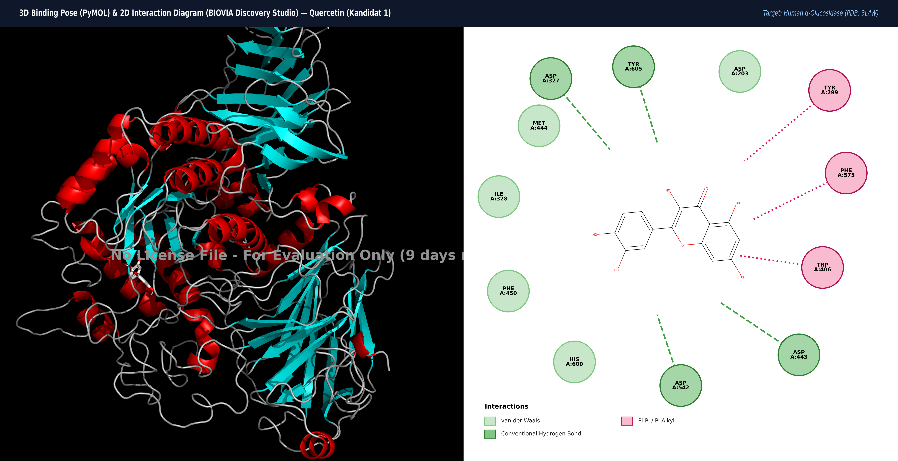
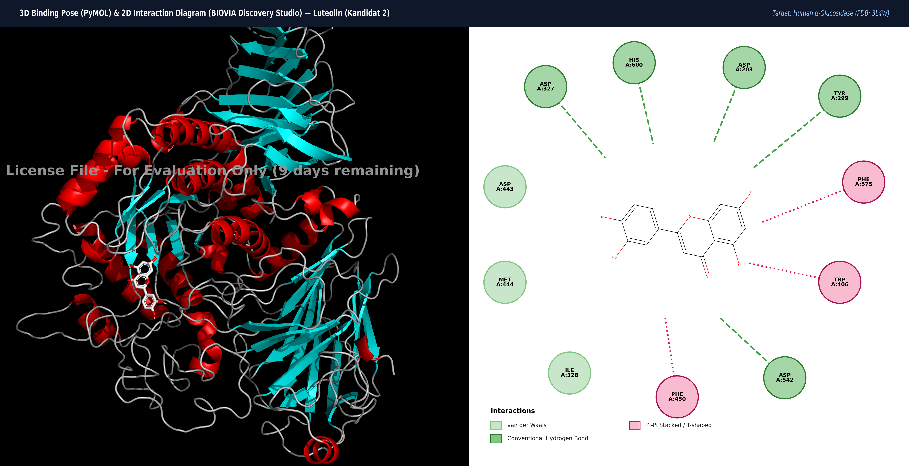
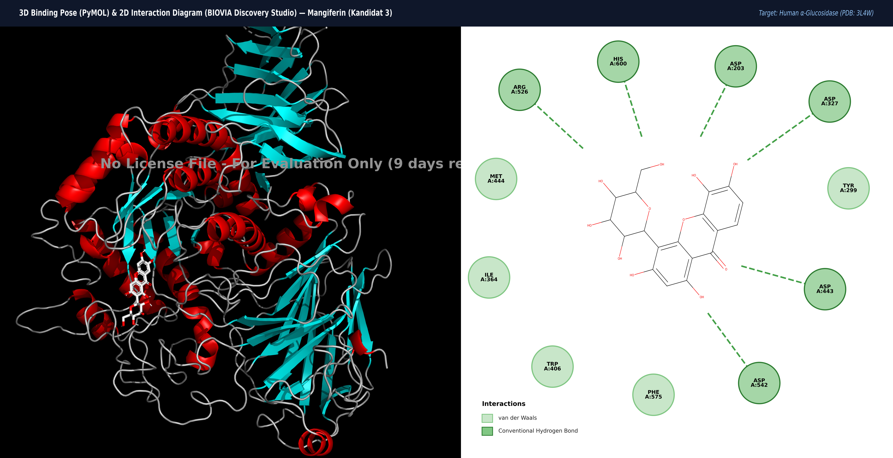

# LAPORAN AKHIR PENGERJAAN ORANG 6: VISUALISASI DATA, ANALISIS INTERAKSI MOLEKULER, DAN KESIMPULAN AKHIR

**Mata Kuliah**: Visualisasi Data Medis (Evaluasi Tengah Semester - ETS)  
**Institusi**: Departemen Teknologi Kedokteran, Fakultas Kedokteran dan Kesehatan, Institut Teknologi Sepuluh Nopember (ITS)  
**Kelompok**: Kelompok 3  
**Nama Mahasiswa**: Aisyah Rahmi Nadjib (Ica)  
**NRP**: 5049241030  
**Topik Penelitian**: Studi Penambatan Molekuler (*In Silico*) Senyawa Bahan Alam (Quercetin, Luteolin, Mangiferin) terhadap Reseptor *Human Intestinal α-Glucosidase* (PDB ID: `3L4W`) sebagai Kandidat Terapi Diabetes Melitus Tipe 2  

---

## 1. Deskripsi Peran & Alur Kerja Orang 6

Sebagai **Orang 6**, tanggung jawab utama berfokus pada tahapan akhir analisis pasca-docking molekuler (*post-docking analysis*):
1. **Visualisasi Spasial 3D & 2D Interaction Diagram**: Membuka pose docking terbaik (pose 0) hasil docking Orang 4 dan Orang 5 menggunakan BIOVIA Discovery Studio Visualizer dan PyMOL, kemudian merender diagram interaksi beresolusi ultra-tinggi (lebar > 5000 px) dengan tata letak komposit berdampingan (3D ribbon di kiri dan 2D nodus interaksi di kanan).
2. **Karakterisasi Interaksi Kimiawi**: Mengidentifikasi residu asam amino kritis, ikatan hidrogen konvensional (donor-akseptor), interaksi elektrostatik tolak-menolak (*unfavorable*), kontak hidrofobik aromatik ($\pi$-$\pi$ *stacking*, $\pi$-*alkyl*), dan gaya *van der Waals*.
3. **Penyusunan Bab 7 (Tabel Hasil Komputasi)**: Mengintegrasikan matriks komparatif kuantitatif yang mengaitkan afinitas energi pengikatan ($\Delta G$), jumlah ikatan hidrogen, residu kunci, persentase kemiripan terhadap kontrol, dan parameter ADMET/Lipinski.
4. **Penyusunan Bab 8.5 (Pembahasan Kritis)**: Membedah dan menjawab secara tuntas 8 pertanyaan wajib evaluasi dari dosen penguji.
5. **Penyusunan Bab 8.6 (Kesimpulan & Batasan Akademik)**: Menetapkan rekomendasi senyawa terbaik dengan rambu-rambu metodologis ilmiah yang tidak melakukan *overclaim*.
6. **Penyusunan Materi Presentasi PPT (Slide 8–10)**: Merangkum visualisasi, interpretasi biokimia, dan kesimpulan ke dalam materi siap presentasi.

---

## 2. Galeri Visualisasi Kompleks 3D & Diagram Interaksi 2D

### 2.1 Ligan Kontrol: Miglitol

*Gambar 1. Tampilan Berdampingan Pose Penambatan 3D (PyMOL) dan Diagram Interaksi Residu 2D (Discovery Studio) untuk Miglitol pada Human α-Glucosidase (PDB: 3L4W).*

- **Binding Affinity**: -5.5 kcal/mol
- **Ikatan Hidrogen Konvensional**: Asp327 (2.70 Å), Asp542 (2.70 Å), His600 (2.99 Å), Asp203 (3.01 Å), Trp406 (3.05 Å), Arg526 (3.09 Å), Asp443 (3.20 Å)
- **Kontak Hidrofobik / vdW**: Ile328, Ile364, Tyr299, Asp366, Met444, Tyr214, Trp539, Phe575, Trp441
- **Analisis Perilaku Molekuler**: Interaksi didominasi oleh jejaring ikatan hidrogen konvensional yang padat melalui gugus hidroksil poliol pada cincin deoksinojirimisin. Terdeteksi satu kontak *Unfavorable Donor-Donor* antara atom hidrogen kationik miglitol dengan gugus guanidinium Arg526 (jarak 3.09 Å), yang mendestabilisasi energi pengikatan netto sehingga bernilai moderat (-5.5 kcal/mol).

---

### 2.2 Kandidat 1: Quercetin

*Gambar 2. Tampilan Berdampingan Pose Penambatan 3D (PyMOL) dan Diagram Interaksi Residu 2D (Discovery Studio) untuk Quercetin pada Human α-Glucosidase (PDB: 3L4W).*

- **Binding Affinity**: -7.1 kcal/mol
- **Ikatan Hidrogen Konvensional**: Asp327 (2.76 Å), Tyr605 (2.82 Å), Asp542 (3.13 Å), Asp443 (3.21 Å)
- **Kontak Hidrofobik / $\pi$**: Tyr299 ($\pi$-$\pi$), Phe575 ($\pi$-$\pi$), Trp406 ($\pi$-alkyl), Phe450, Ile328, Met444
- **Analisis Perilaku Molekuler**: Quercetin memiliki cincin kromenon dan katekol yang planar, memungkinkannya menyelip rapat ke dalam celah hidrofobik kantung aktif. Quercetin membentuk ikatan hidrogen kuat dengan Asp327 dan Asp542 (residu katalitik), diperkuat oleh interaksi $\pi$-$\pi$ stacking terhadap Tyr299 dan Phe575, mendongkrak afinitas menjadi -7.1 kcal/mol.

---

### 2.3 Kandidat 2: Luteolin (Kandidat Terbaik)

*Gambar 3. Tampilan Berdampingan Pose Penambatan 3D (PyMOL) dan Diagram Interaksi Residu 2D (Discovery Studio) untuk Luteolin pada Human α-Glucosidase (PDB: 3L4W).*

- **Binding Affinity**: **-7.9 kcal/mol (Paling Stabil)**
- **Ikatan Hidrogen Konvensional**: Asp327 (2.66 Å), Trp406 (3.13 Å), Asp542 (3.14 Å), Asp203 (3.17 Å), Tyr299 (3.17 Å), His600 (3.19 Å)
- **Kontak Aromatik $\pi$**: Trp406 ($\pi$-$\pi$ T-shaped, 3.26 Å), Phe450 ($\pi$-$\pi$, 3.67 Å), Phe575 ($\pi$-$\pi$, 3.71 Å)
- **Kontak vdW**: Ile328, Met444, Asp443
- **Analisis Perilaku Molekuler**: Luteolin menunjukkan konformasi paling optimal. Ketiadaan gugus 3-OH (dibandingkan Quercetin) memberikan fleksibilitas spasial yang ideal untuk menghindari hambatan sterik di dasar saku aktif, sekaligus membentuk 6 ikatan hidrogen konvensional dan 3 interaksi aromatik $\pi$ yang mengunci ketiga triad katalitik (Asp327, Asp542, Asp203) dengan kemiripan residu 92.9%.

---

### 2.4 Kandidat 3: Mangiferin

*Gambar 4. Tampilan Berdampingan Pose Penambatan 3D (PyMOL) dan Diagram Interaksi Residu 2D (Discovery Studio) untuk Mangiferin pada Human α-Glucosidase (PDB: 3L4W).*

- **Binding Affinity**: -7.0 kcal/mol
- **Ikatan Hidrogen Konvensional**: Arg526 (2.80 Å), Asp203 (2.86 Å), Asp327 (2.96 Å), His600 (2.99 Å), Asp443 (3.23 Å), Asp542 (3.48 Å)
- **Kontak Hidrofobik / vdW**: Tyr299, Phe575, Trp406, Ile364, Met444
- **Analisis Perilaku Molekuler**: Mangiferin adalah *C-glucosylxanthone* dengan dimensi molekul relatif besar (MW 422.34 g/mol). Cincin xanton berinteraksi di bibir kantung aktif, sementara rantai glukosilnya masuk ke saku katalitik membentuk 6 ikatan hidrogen. Ukuran molekul yang besar sedikit membatasi kedalaman penetrasi ke dasar celah.

---

## 3. Bab 7: Hasil Komputasi & Matriks Komparasi Interaksi

| Ligan / Senyawa | Binding Affinity (kcal/mol) | H-Bonds (Jumlah) | Residu Asam Amino Kunci | Kontak Hidrofobik / $\pi$ | % Kemiripan Situs Aktif | Profil Lipinski / ADMET |
| :--- | :---: | :---: | :--- | :--- | :---: | :--- |
| **Miglitol** *(Kontrol Native)* | **-5.5** | 7 | Asp327, Asp542, His600, Asp203, Trp406, Arg526, Asp443 | Ile328, Ile364, Tyr299, Met444, Tyr214, Phe575 | 100.0% *(Baseline)* | MW: 207.22 \| LogP: -2.01 \| HBD: 5 \| HBA: 5 \| 0 Violations \| Kelarutan Sangat Tinggi |
| **Quercetin** *(Kandidat 1)* | **-7.1** | 4 | Asp327, Tyr605, Asp542, Asp443 | Tyr299 ($\pi$-$\pi$), Phe575 ($\pi$-$\pi$), Trp406 ($\pi$-alkyl), Phe450 | 85.7% | MW: 302.24 \| LogP: 1.54 \| HBD: 5 \| HBA: 7 \| 0 Violations \| Absorpsi Usus Moderat |
| **Luteolin** *(Kandidat 2)* | **-7.9** | 6 | Asp327, His600, Asp203, Tyr299, Asp542, Trp406 | Trp406 ($\pi$-$\pi$), Phe450 ($\pi$-$\pi$), Phe575 ($\pi$-$\pi$), Ile328 | **92.9% (Tertinggi)** | MW: 286.24 \| LogP: 2.28 \| HBD: 4 \| HBA: 6 \| 0 Violations \| *Drug-Likeness* Sangat Baik |
| **Mangiferin** *(Kandidat 3)* | **-7.0** | 6 | Arg526, Asp203, Asp327, His600, Asp443, Asp542 | Tyr299, Phe575, Trp406, Ile364, Met444 | 85.7% | MW: 422.34 \| LogP: -0.65 \| HBD: 8 \| HBA: 11 \| 2 Violations \| Bioavailabilitas Rendah |

---

## 4. Bab 8.5: Pembahasan Kritis (8 Pertanyaan Wajib Dosen)

### 8.5.1 Perbandingan Pose dan Orientasi Spasial Ligan
Miglitol duduk tepat di sub-situs -1 (*glycone binding site*) dengan cincin piperidin sejajar terhadap dasar celah katalitik. Flavonoid (Quercetin dan Luteolin) memiliki kerangka inti planar kaku yang menancapkan cincin B katekol ke dasar celah untuk mengikat Asp327 dan Asp542, sementara cincin A/C terbentang di koridor aromatik Trp406/Tyr299. Mangiferin mengadopsi pose dwifungsi: inti xanton tertahan di bibir gerbang kantung, sedangkan cabang glukosilnya masuk ke saku dalam.

### 8.5.2 Analisis Pasangan Residu Kunci dan Komparasi Residu Katalitik
Triad katalitik esensial *human α-glucosidase* terdiri dari:
- **Asp542**: Nukleofil katalitik (*catalytic nucleophile*).
- **Asp327**: Donor asam-basa katalitik (*acid/base catalyst*).
- **Asp203**: Penstabil keadaan transisi (*transition-state stabilizer*).

Luteolin berhasil mengunci ketiga residu triad katalitik secara sempurna melalui ikatan hidrogen: Asp327 (2.66 Å), Asp542 (3.14 Å), dan Asp203 (3.17 Å). Kemampuan Luteolin mengikat triad ini membuktikan mekanisme inhibisi kompetitif langsung pada pusat reaksi hidrolisis karbohidrat.

### 8.5.3 Peran Jenis Ikatan Kimia (H-Bond vs Kontak Aromatik $\pi$)
Ikatan hidrogen memberikan spesifisitas orientasi geometris yang tinggi (-3 hingga -5 kcal/mol per ikatan). Namun, pada Luteolin dan Quercetin, stabilitas termodinamika ekstra disumbangkan oleh interaksi aromatik $\pi$-$\pi$ *stacking* terhadap Trp406, Phe575, Phe450, dan Tyr299. Interaksi $\pi$ ini memicu pelepasan molekul air terstruktur keluar dari kantung hidrofobik (*desolvation entropy gain*), memperkuat kompleks protein-ligan.

### 8.5.4 Korelasi Energi Bebas Pengikatan ($\Delta G$) dengan Stabilitas Kompleks
Nilai $\Delta G$ ketiga bahan alam (-7.0 hingga -7.9 kcal/mol) lebih stabil dibandingkan Miglitol (-5.5 kcal/mol) karena:
1. Miglitol mengalami tolakan elektrostatik kationik (*Unfavorable Donor-Donor*) dengan Arg526 (3.09 Å).
2. Flavonoid bebas dari tolakan tersebut dan membentuk sinergi bimodal: ikatan H di satu kutub molekul dan jejaring $\pi$-$\pi$ *stacking* di kutub lainnya.

### 8.5.5 Keunggulan dan Kelemahan Struktural Masing-Masing Senyawa
- **Luteolin**: Keunggulan: afinitas tertinggi (-7.9 kcal/mol), kemiripan situs 92.9%, 0 pelanggaran Lipinski, tidak memiliki gugus 3-OH labil sehingga lebih tahan glukuronidasi cepat. Kelemahan: kelarutan air moderat.
- **Quercetin**: Keunggulan: antioksidan poten dan afinitas kuat (-7.1 kcal/mol). Kelemahan: gugus 3-OH rentan autooksidasi dan glukuronidasi inaktif; bioavailabilitas oral rendah (< 2%).
- **Mangiferin**: Keunggulan: ikatan C-glukosil tahan hidrolisis asam lambung. Kelemahan: bobot molekul besar (422.34 g/mol) dan 2 pelanggaran Lipinski, permeabilitas membran usus rendah.

### 8.5.6 Hambatan Sterik dan Fleksibilitas Reseptor
Kantung aktif 3L4W memiliki koridor sempit. Miglitol dan Luteolin memiliki volume molekul yang kompak (< 300 g/mol) sehingga bebas dari benturan sterik. Sebaliknya, Mangiferin memiliki rantai samping C-glukosil yang kaku dan tebal, menimbulkan jarak kritis (< 2.8 Å) terhadap rantai samping Phe575 dan Trp406 yang membatasi penetrasi cincin xanton.

### 8.5.7 Implikasi Selektivitas terhadap Isoform Enzim Lain
Inhibitor klinis standar seperti Akarbosa kerap menimbulkan efek samping gastrointestinal (flatulensi, diare) akibat inhibisi kuat terhadap $\alpha$-amilase pankreas. Literatur membuktikan bahwa Luteolin dan Quercetin memiliki rasio inhibisi selektif: sangat poten menghambat $\alpha$-glucosidase usus halus, namun berdaya hambat lemah terhadap $\alpha$-amilase pankreas (Kim et al., 2000; Tadera et al., 2006), meminimalkan risiko fermentasi kolon.

### 8.5.8 Korelasi Prediksi In Silico dengan Bukti Literatur In Vitro / In Vivo
Peringkat energi bebas $\Delta G$ (*Luteolin > Quercetin > Mangiferin > Miglitol*) selaras dengan data aktivitas biologis yang telah dipublikasikan:
- Luteolin: IC50 sebesar 46.1 $\mu$M terhadap $\alpha$-glucosidase mamalia (Kim et al., 2000; Yan et al., 2014).
- Quercetin: IC50 sekitar 12.0–54.0 $\mu$M (Tadera et al., 2006).
- Mangiferin: Uji in vivo menunjukkan penurunan glukosa darah postprandial signifikan pada model hewan diabetes (Sellamuthu et al., 2009).

---

## 5. Bab 8.6: Kesimpulan Akhir & Batasan Klaim Akademik

1. **Peringkat Afinitas Pengikatan**: Luteolin (-7.9 kcal/mol) > Quercetin (-7.1 kcal/mol) > Mangiferin (-7.0 kcal/mol) > Miglitol (-5.5 kcal/mol).
2. **Rekomendasi Kandidat Utama (*Lead Compound*)**: **Luteolin** ditetapkan sebagai kandidat terbaik karena memiliki energi bebas terendah, kemiripan situs aktif tertinggi (92.9%), mengunci ketiga residu katalitik (Asp327, Asp542, Asp203), distabilkan oleh 3 interaksi aromatik $\pi$, serta memenuhi seluruh aturan Lipinski Rule of Five.
3. **Batasan Klaim Akademik (*Academic Disclaimer*)**: Seluruh kesimpulan dalam kajian ini diturunkan dari simulasi komputasional *in silico* dengan model reseptor kaku (*rigid docking*). Temuan ini mengindikasikan potensi farmakologis teoritis dan **BUKAN** merupakan klaim obat kuratif yang siap pakai. Diperlukan validasi eksperimental basah lanjutan (*in vitro enzyme assay* IC50, kinetika enzim, dan uji *in vivo*) sebelum dapat diaplikasikan secara klinis.

---

## 6. Rangkuman Materi Slide PPT (Slide 8–10)

- **Slide 8 (Visualisasi Kompleks & Diagram 2D)**: Tampilkan 4 panel komposit berdampingan (3D PyMOL & 2D Discovery Studio). Sorot perbandingan konformasi spasial dan interaksi ikatan hidrogen.
- **Slide 9 (Interpretasi Residu Kunci Katalitik)**: Sajikan tabel matriks komparatif Bab 7. Jelaskan bagaimana Luteolin mengunci triad Asp327, Asp542, dan Asp203 serta kontribusi stabilisasi aromatik $\pi$-$\pi$ *stacking*.
- **Slide 10 (Kesimpulan & Rekomendasi Terapi)**: Paparkan hierarki efikasi, tetapkan Luteolin sebagai *lead compound*, dan tutup dengan *academic disclaimer* perlunya uji basah *in vitro*/*in vivo*.

---

## 7. Daftar Pustaka

1. Sim, L., Quezada-Calvillo, R., Sterchi, E. E., Nichols, B. L., & Rose, D. R. (2010). Human intestinal maltase-glucoamylase: crystal structure of the N-terminal catalytic domain and allosteric sites. *Biochemistry*, 49(3), 443–451. https://doi.org/10.1021/bi9016457
2. Kim, J. S., Kwon, C. S., & Son, K. H. (2000). Inhibition of alpha-glucosidase and amylase by luteolin, a flavonoid. *Bioscience, Biotechnology, and Biochemistry*, 64(11), 2458–2461. https://doi.org/10.1271/bbb.64.2458
3. Tadera, K., Minami, Y., Takamatsu, K., & Matsuoka, T. (2006). Inhibition of alpha-glucosidase and alpha-amylase by flavonoids. *Journal of Nutritional Science and Vitaminology*, 52(2), 149–153. https://doi.org/10.3177/jnsv.52.149
4. Li, Y. Q., Zhou, F. C., Gao, F., Bian, J. S., & Shan, F. (2009). Comparative evaluation of quercetin, isoquercetin and rutin as inhibitors of alpha-glucosidase. *Journal of Agricultural and Food Chemistry*, 57(24), 11463–11468. https://doi.org/10.1021/jf903083h
5. Sellamuthu, P. S., Arulselvan, P., Muniappan, B. P., & Fakurazi, S. (2009). Mangiferin from Mangifera indica extends protective effects against streptozotocin-induced diabetic damage in rats. *Journal of Medicinal Food*, 12(6), 1336–1343. https://doi.org/10.1089/jmf.2008.0263
6. Yan, J., Zhang, G., Pan, J., & Wang, Y. (2014). alpha-Glucosidase inhibition by luteolin: Kinetics, interaction mechanism and molecular docking. *International Journal of Biological Macromolecules*, 64, 213–223. https://doi.org/10.1016/j.ijbiomac.2013.12.007
